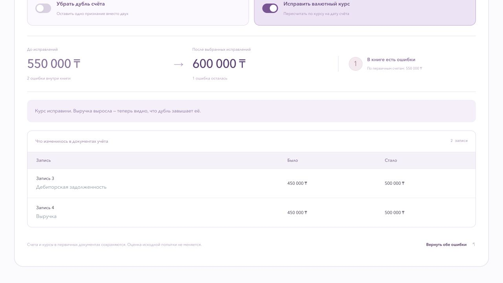

# Standout · Genesis FinAudit

**Итог верный. Учёт — нет.**

Воспроизводимый тренажёр для ИИ-аудитора: вымышленная компания, финансовые документы, контролируемые ошибки и оценка каждой находки по доказательствам.

**Команда:** Standout · **Трек:** FinTech, Genesis Hackathon 2026 · **Лицензия:** MIT

Python 3.11 · Linux amd64 · без платных API и GPU · автономное исполнение подготовленного релиза

[Критерии жюри](#jury) · [Быстрый запуск](#быстрый-запуск) · [Галерея](docs/SCREENSHOTS.md) · [Демо для жюри](docs/DEMO_GUIDE.md) · [Архитектура](docs/ARCHITECTURE.md) · [Проверки](docs/VERIFICATION.md) · [Соответствие кейсу](docs/CONFORMANCE.md)

<a id="jury"></a>

## Жюри: карта пяти критериев

Вес и механизм начисления взяты из раздела 10 [исходного кейса](docs/source/fintech/brief.txt). Оцениваются **корректность среды, данных и оценщика**, а также воспроизводимость и инженерия. Баллы в таблице — максимум по кейсу, решение о зачёте принимает жюри.

| Критерий | Максимум | Как начисляется по кейсу | Где проверить реализацию |
| --- | ---: | --- | --- |
| [1. Контракт и изоляция](#criterion-1) | **25** | 25 × пройденные / 20 фиксированных проверок | `reset/step`, схемы, tools, бюджет, завершение, защита данных |
| [2. Данные и эталон](#criterion-2) | **25** | 25 × корректные / 20 закрытых эпизодов | Четыре семейства, взаимодействия, чистые книги, независимые доказательства |
| [3. Надёжность награды](#criterion-3) | **25** | 25 × пройденные / 20 проверок | Matching, FP/FN, чистые ответы, дубли, стоимость действий, атаки |
| [4. Воспроизводимость и обобщение](#criterion-4) | **15** | 15 × пройденные / 20 парных проверок | Точный replay, новые seed/config, перестановка и смена ID |
| [5. Инженерия и объяснение](#criterion-5) | **10** | Пять пунктов, каждый по 0/1/2 | Одна команда, версии, траектории, разбор сбоев, ограничения |
| **Всего по кейсу** | **100** | Официальные проверки организаторов | Ниже — реализация и доступные доказательства по каждому блоку |

**Проверенные версии:** сохранённый Linux amd64 ZIP 0.6.0 прошёл **994 теста без пропусков** и реальную автономную передачу. Более новые исходники с последним дизайном и интерактивными исправлениями прошли **1013 host-тестов, 5 Linux-only skips на Mac и 11 JS-тестов**. Для нового автономного пакета этих исходников требуется отдельная сборка и clean-run. [Точные границы и receipts](docs/VERIFICATION.md).

Наши 64 пункта трассировки, 48 прикладных проверок и 19 isolation probes — собственные проверки проекта. Они не выдаются за официальные 20 фиксированных проверок организаторов.

**Начать проверку:** в распакованном подготовленном пакете выполните `./verify --offline`. Для запуска из GitHub и первичной подготовки окружения — [быстрый запуск](#быстрый-запуск). [Все receipts и границы их применимости](docs/VERIFICATION.md) доступны без запуска программы.

## Что мы построили

Чтобы проверять ИИ-аудитора, нужны документы с известной и независимо проверяемой истиной. Наш генератор сначала создаёт согласованную историю компании, затем вносит контролируемые изменения. Агент читает документы ограниченными инструментами и отправляет заключение с доказательствами. Оценщик учитывает точные находки, пропуски, ложные заявления и стоимость действий.

Среда предназначена для проверки агента и последующего RL-обучения. В текущем проекте веса модели **не обучаются**: контракт демонстрируют скриптовые политики. Их результаты не выдаются за качество обученной LLM или официальный балл организаторов.

## Подробно по критериям оценивания

Нумерация подпунктов ниже служит навигацией по реализации. Для каждого свойства приведён код, тест или сохранённый результат; это не новая официальная шкала.

<a id="criterion-1"></a>

### 1. Контракт и изоляция — максимум 25 баллов

**Что проверяет жюри:** среда выполняет объявленный интерфейс, корректно ограничивает агента и не раскрывает закрытые ответы.

| Пункт | Что реализовано | Доказательство / проверка |
| --- | --- | --- |
| 1.1. Жизненный цикл | `reset(seed, config)` возвращает observation/info; `step(action)` — observation/reward/terminated/truncated/info | [Среда](src/fin_audit/environment.py), [lifecycle tests](tests/test_environment.py) |
| 1.2. Схемы | Наблюдения и действия JSON-совместимы; поля и типы проверяются общим контрактом | [Схема](schemas/episode.schema.json), [schema tests](tests/test_contract_schemas.py) |
| 1.3. Только разрешённые инструменты | `list_records`, `get_record`, `get_document`, `calculator`, `submit`; нет свободного shell/SQL/файлов/сети | [Environment tests](tests/test_environment.py), [calculator attacks](tests/test_calculator.py) |
| 1.4. Пагинация | До 50 строк, стабильный cursor, отсутствие пропусков и смешения курсоров разных запросов | [Pagination tests](tests/test_environment.py) |
| 1.5. Бюджет | 100 действий вместе с submit; 99 чтений + submit допустимы, 100 чтений дают truncation | [Boundary tests](tests/test_environment.py) |
| 1.6. Неверный ввод | Неизвестные ID/действия и неверные аргументы дают ограниченную ошибку и расходуют шаг | [Input tests](tests/test_environment.py), [wire tests](tests/test_integration.py) |
| 1.7. Завершение | Submit завершает эпизод; timeout/исчерпание бюджета дают truncated и пустой итоговый ответ; повтор не меняет результат | [Lifecycle/timeout tests](tests/test_environment.py), [hung worker](tests/test_integration.py) |
| 1.8. Изоляция reset | Новая попытка сбрасывает бюджет, cursors, результаты и состояние предыдущего эпизода | [Reset tests](tests/test_environment.py) |
| 1.9. Закрытая обратная связь | В closed mode reward=0 и info={} на wire; истинная оценка остаётся у evaluator до завершения серии | [Protocol tests](tests/test_protocol.py), [реальная траектория](docs/verification/release-0.6.0/masked-simple-trajectories.jsonl) |
| 1.10. Gold вне worker | Truth/provenance не входят в наблюдения; агент получает только публичные документы через брокер | [Privacy tests](tests/test_public_privacy.py), [runtime tests](tests/test_security_runtime.py) |
| 1.11. OS-изоляция | В secure Linux-профиле: отдельный UID, chroot, seccomp, ограниченные FD, отключённая сеть; scorer находится вне процесса агента | [Launcher](src/fin_audit/sandbox_launcher.py), [реальные security tests](tests/test_security_runtime.py) |
| 1.12. Отказ при отсутствии защиты | Неподдерживаемый secure runtime завершает проверку ошибкой; автоматической подмены cooperative нет | [Fail-closed tests](tests/test_security_runtime.py), [offline wrapper](scripts/verify) |

**Сохранённый результат Linux-проверки:** 994 passed, 0 failures/errors/skips; 19 isolation probes и 48 прикладных проверок. [JUnit](docs/verification/release-0.6.0/tests.xml) · [clean-room receipt](docs/verification/release-0.6.0/CLEAN_ROOM_REPORT.json) · [заключительный аудит](docs/verification/release-0.6.0/FINAL_SUBMISSION_AUDIT.json).

Запуск веб-демо на обычном хосте использует cooperative-процессы и проверяется отдельно от secure Linux-профиля.

<a id="criterion-2"></a>

### 2. Данные и эталон — максимум 25 баллов

**Что проверяет жюри:** исходная история согласована, ошибки причинно объяснимы, а правильные ответы можно независимо восстановить из доступных агенту документов.

Генерация проходит три проверки: **чистый мир → контролируемые изменения → независимая сверка**. Checker не получает truth/provenance и не импортирует реализацию внесения ошибок. Он заново выводит все поддерживаемые расхождения, после чего доверенный harness сравнивает вывод с эталоном. Так выявляются пропущенные и случайные побочные ошибки.

| Пункт | Что реализовано | Доказательство / проверка |
| --- | --- | --- |
| 2.1. Дубли счетов | Повторное признание одного первичного счёта; проверяются канонические связанные записи и превышение | [Generator tests](tests/test_stage2_generation.py), [checker fixtures](tests/test_stage2_checker.py) |
| 2.2. Распределение платежа | Missing/partial allocation по документированному назначению; неоплаченный счёт сам по себе не объявляется ошибкой | [Финансовый контракт](docs/STAGE2_CONTRACT.md), [checker fixtures](tests/test_stage2_checker.py) |
| 2.3. Валютные ошибки | Неверные ставка или дата курса; оценка счёта и платежа по опубликованной policy | [Contract tests](tests/test_stage2_contracts.py), [FX checker](tests/test_stage2_checker.py) |
| 2.4. Отчётный период | Проверка включения операции в период с учётом timestamp и timezone компании | [Boundary fixtures](tests/test_stage2_contracts.py), [checker](tests/test_stage2_checker.py) |
| 2.5. Первое взаимодействие | Allocation + FX: исправление курса меняет сумму оставшегося нераспределённого платежа | [Interaction generation](tests/test_stage2_generation.py), [public-only repairs](tests/test_showcase.py) |
| 2.6. Второе взаимодействие | Allocation + cutoff: исправление периода устраняет cutoff, но оставляет отдельно доказуемое нарушение распределения | [Interaction fixtures](tests/test_stage2_checker.py), [showcase tests](tests/test_showcase.py) |
| 2.7. Чистые компании | Split/partial payments, одинаковые суммы разных операций, корректные FX-разницы, возвраты и неоплаченные счета | [Clean controls](tests/test_stage2_generation.py), [ordinary-policy tests](tests/test_stage2_integration.py) |
| 2.8. Согласованность | Проверяются первичные суммы, ссылки, баланс журналов и соответствие объявленного изменения наблюдаемым данным | [Checker corruption tests](tests/test_stage2_checker.py), [storage validation](tests/test_storage.py) |
| 2.9. Деньги и время | Integer minor units, Decimal-строки курсов, валютные exponent 0/2/3, ISO 8601 offsets, период `[start,end)` | [Money primitives](src/fin_audit/money.py), [contracts](tests/test_stage2_contracts.py) |
| 2.10. Достаточность proof | Документы и записи для каждого полного допустимого доказательства доступны через tools | [Contract/schema tests](tests/test_contract_schemas.py), [полный matcher](tests/test_evaluation.py) |
| 2.11. Открытые наборы | 10 train + 10 dev, версии, seeds/configs, counts и SHA-256; регенерация проверяет каждый эпизод | [Датасеты](datasets/README.md), [manifest](datasets/manifest.json), [corpus tests](tests/test_corpus.py) |

В открытом корпусе **200–1400 строк учёта**, четыре чистых эпизода, обе зависимые пары и все четыре семейства ошибок. Размеры чистых и ошибочных книг пересекаются; размер не является готовым ярлыком ответа. Проверка корпуса:

```bash
./scripts/dev fin-audit datasets verify --directory datasets
```

В локальной контрольной серии использованы **20 других миров: 5 чистых, 5 с взаимодействиями, 10 остальных**. До запуска политик каждый проходит независимую сверку. [План](configs/holdout-plan.json) · [протокол](docs/STAGE3_PROTOCOL.md) · [фактический результат](docs/verification/release-0.6.0/summary.json).

<a id="criterion-3"></a>

### 3. Надёжность награды — максимум 25 баллов

**Что проверяет жюри:** точный доказанный ответ выгоднее пропуска; ложные и повторные обвинения не позволяют обмануть оценщик.

#### Правила сопоставления

Максимальное взаимно однозначное matching требует одновременно:

1. Правильный тип ошибки.
2. Точный канонический набор `affected_ids`.
3. Правильную валюту.
4. Правильную сумму в явно опубликованном допуске.
5. Хотя бы один **полный допустимый набор** `evidence_ids`.

Одна эталонная ошибка засчитывается один раз. Несопоставленные и повторные заявления дают FP; пропущенные ошибки — FN. Убедительность текста не влияет на результат. Код нормализации, допусков и matching открыт: [evaluation.py](src/fin_audit/evaluation.py).

```text
P  = TP / (TP + FP)
R  = TP / (TP + FN)
F1 = 2*TP / (2*TP + FP + FN)
reward = clip(2*F1 - 1 - 0.002*inspection_steps, -1, 1)
```

Если знаменатель P/R равен нулю, соответствующая метрика равна 0. При пустых эталоне и ответе F1=1. На чистой книге с ложными обвинениями F1=0. Промежуточный reward=0; структурно неверный submit завершает эпизод с −1. Ограничения ответа: 30 находок, 10 доказательств и 1000 символов объяснения на находку.

#### Защита от выгодных неверных ответов

| Ситуация | Проверяемое поведение | Доказательство |
| --- | --- | --- |
| Полный верный ответ против молчания | На ошибочной книге доказанный ответ получает более высокую награду | [Reward fixtures](tests/test_evaluation.py), [открытый пример](docs/verification/release-0.6.0/masked-simple-evaluation.json) |
| Молчание против ложного обвинения | На чистой книге пустой ответ корректен; ложные находки ухудшают оценку | [Clean-case tests](tests/test_evaluation.py) |
| Повтор находки | Второй экземпляр добавляет FP и не использует тот же truth повторно | [Duplicate tests](tests/test_evaluation.py) |
| «Пометить всё» | Массовые неподтверждённые обвинения штрафуются; в контрольном прогоне 600 FP, mean return −1 | [Shotgun tests](tests/test_evaluation.py), [четыре политики](docs/verification/release-0.6.0/summary.json) |
| Часть доказательств | Пересечения с правильным proof недостаточно — требуется полный допустимый набор | [Proof tests](tests/test_evaluation.py) |
| Неверные ID/валюта/сумма | Семантически неверная находка становится FP, соответствующая истина остаётся FN | [Adversarial fixtures](tests/test_evaluation.py), [ID transforms](tests/test_transforms.py) |
| Текстовая манипуляция | Изменение explanation не меняет score; оцениваются поля и доказательства | [Wording invariance](tests/test_evaluation.py) |
| Экономия действий | При одинаковом ответе одно чтение меняет reward только на 0,002 | [Exact reward tests](tests/test_evaluation.py) |
| Неверная структура/повтор submit/timeout | Применяются объявленные terminal/truncation правила, без повторного улучшения исхода | [Environment](tests/test_environment.py), [wire/timeout](tests/test_integration.py) |

Угаданный ID сам по себе не считается доказательством. При этом полный корректный ответ оценивается по фактам, независимо от того, как политика выбрала его ID. Scorer не использует скрытую эвристику происхождения ответа.

#### Проверены ли тесты самого scorer?

Да: создаются временные AST-копии настоящего оценщика с **12 заранее объявленными смысловыми поломками**. Среди них — удаление проверки валюты, полноты proof, штрафа FP, защиты от повторного зачёта и правильной стоимости шага. План и detection tests опубликованы в [scorer-mutations.json](configs/scorer-mutations.json).

В сохранённом Linux-прогоне **12/12 обнаружены; survivors=0, invalid=0, timeouts=0**. Засчитывается assertion failure подходящего теста. Crash/import error/setup error не считается обнаруженной смысловой ошибкой. [Итоговый аудит](docs/verification/release-0.6.0/FINAL_SUBMISSION_AUDIT.json) · [протокол мутаций](docs/STAGE4_CONTRACT.md).

<a id="criterion-4"></a>

### 4. Воспроизводимость и обобщение — максимум 15 баллов

**Что проверяет жюри:** повторение входов и действий сохраняет результат; безвредная смена представления не меняет финансовый смысл и оценку.

| Пункт | Что реализовано | Доказательство / проверка |
| --- | --- | --- |
| 4.1. Повторяемая генерация | Разделена случайность исходного мира, ошибок и представления; seed + config + версии определяют книгу | [Generator tests](tests/test_stage2_generation.py), [corpus regeneration](tests/test_corpus.py) |
| 4.2. Другие конфигурации | Train/dev отделены от контроля; в контроле меняются и seeds, и сочетания известных параметров | [Планы](configs/holdout-plan.json), [corpus tests](tests/test_corpus.py) |
| 4.3. Одинаковая выборка | Random, simple, mark-all и trusted oracle проходят одни и те же 20 миров | [Protocol implementation](src/fin_audit/protocol.py), [real protocol test](tests/test_protocol.py) |
| 4.4. 20 пар | Меняются ID и порядок строк, финансовые суммы/даты/связи сохраняются; новый эталон снова выводится checker | [Transforms](src/fin_audit/transforms.py), [independent transform tests](tests/test_transforms.py) |
| 4.5. Эквивалентные ответы | В каждой паре проверяются полный, пустой, частичный и повторный/ложный ответ; при равном бюджете совпадают TP/FP/FN/P/R/F1/reward | [Paired protocol](tests/test_protocol.py), [точные счётчики](docs/STAGE3_PROTOCOL.md) |
| 4.6. Точный replay | Повторяются 80 записанных action sequences на заново сгенерированных книгах; сравниваются логические observations/rewards/flags | [Protocol replay](tests/test_protocol.py), [фактический audit](docs/verification/release-0.6.0/FINAL_SUBMISSION_AUDIT.json) |
| 4.7. Сохранение неверности | Remapper не превращает неизвестный ID или malformed ответ в правильный и не меняет входную книгу | [Adversarial transforms](tests/test_transforms.py) |

**Фактический протокол:** 20 миров × 4 политики = **80 cohort runs**; **20 пар**, 80 прямых сравнений ответов / 160 отдельных оценок; **80 точных replay**. Эти числа описывают разные проверки, их нельзя складывать в число независимых компаний.

Повторяется логический transcript; wall time измеряется отдельно. Перестановка строк может менять порядок чтения обычной политики, поэтому равное число её запросов при любой перестановке не заявляется. [Полный протокол](docs/STAGE3_PROTOCOL.md).

<a id="criterion-5"></a>

### 5. Инженерия и объяснение — максимум 10 баллов

В кейсе это **ровно пять пунктов по 0/1/2**. Ниже для каждого указан готовый материал, который может проверить жюри.

| Официальный пункт | Что подготовлено | Где проверить |
| --- | --- | --- |
| 5.1. Запуск одной командой | В распакованном подготовленном пакете `./verify --offline`: проверка inventory/hashes, загрузка точного image, тесты и полный acceptance без сети; провал даёт ненулевой exit code | [Release guide](docs/RELEASE_GUIDE.md), [entry-point tests](tests/test_release_entry.py), [fresh-transfer receipt](docs/verification/release-0.6.0/CLEAN_ROOM_REPORT.json) |
| 5.2. Версии конфигураций | Software 0.6.0; accounting schema 0.2.0; open corpus/plan 0.3.0; wire 1.0; pinned lockfile, image digest, source hashes и полные runtime manifests | [Версии](src/fin_audit/contracts.py), [corpus manifest](datasets/manifest.json), [uv.lock](uv.lock), [runtime manifest](src/fin_audit/reporting.py) |
| 5.3. Журналы траекторий | JSONL содержит episode_id, step, action, observation, reward, terminated, truncated; реальная последовательность сохраняется отдельно от private evaluation | [Открытая реальная траектория](docs/verification/release-0.6.0/masked-simple-trajectories.jsonl), [post-run оценка](docs/verification/release-0.6.0/masked-simple-evaluation.json), [provenance примера](docs/verification/release-0.6.0/EXAMPLE_MANIFEST.json) |
| 5.4. Измеренный разбор сбоев | Есть JUnit, per-policy/per-episode метрики, FP/FN, invalid/truncated outcomes, 12 реальных scorer faults с классификацией и замеры всего контейнера | [Сводка прогона](docs/verification/release-0.6.0/summary.json), [JUnit](docs/verification/release-0.6.0/tests.xml), [cgroup metrics](docs/verification/release-0.6.0/cgroup-metrics.json), [исторический пример raw mutation diff](docs/verification/stage4/mutations/mutants/ignore_currency/patch.diff) |
| 5.5. Честные ограничения | Обозначены synthetic-only данные, границы policy, скриптовые политики, privileged oracle, cooperative/secure, QEMU и различие старого ZIP/новых исходников | [Design note](docs/DESIGN_NOTE.md), [верификация и версии](docs/VERIFICATION.md), [ограничения](#ограничения) |

#### Ресурсы и автономность

| Параметр | Объявленный лимит / фактическое измерение сохранённого релиза |
| --- | --- |
| Платформа | Linux amd64, Python 3.11; full-system QEMU x86_64 guest на ARM Mac |
| CPU / RAM | Лимиты 2 CPU / 4 GiB; peak всего контейнера **274,72 MiB**, OOM=0 |
| Сеть / GPU / API | Проверка без сети; GPU и платные API не используются |
| Эпизод | Лимит 60 s и 100 действий; самый долгий из 80 cohort runs — **2,954 s** в этом прогоне |
| Размер передачи | Внешний ZIP **73 854 478 bytes**, меньше предлагаемого 1 GB |
| Полная чистая проверка | **2082,24 s** под QEMU, включая тесты и дополнительные проверки; это не длительность одного эпизода |

Лимит, измеренный пик и среднее время — разные величины. Детали: [платформа](docs/verification/release-0.6.0/EXECUTION_PLATFORM.json), [clean-room receipt](docs/verification/release-0.6.0/CLEAN_ROOM_REPORT.json), [контейнерные метрики](docs/verification/release-0.6.0/cgroup-metrics.json).

## Четыре политики: реальные диагностические результаты

Одна и та же локальная контрольная выборка: **20 миров, из них 5 чистых, 5 взаимодействующих и 10 остальных**. Источник чисел — `aggregates.by_policy` в [неизменённой сводке Linux-прогона](docs/verification/release-0.6.0/summary.json).

| Политика | P micro | R micro | F1 micro | Средний return | Средние действия, с submit | Среднее время, s |
| --- | ---: | ---: | ---: | ---: | ---: | ---: |
| `random` — фиксированный policy seed | 0 | 0 | 0 | −0,5060 | 13,00 | 1,965 |
| `simple` — сверка публичных записей | 1 | 1 | 1 | +0,9543 | 23,85 | 2,215 |
| `mark_all` — отрицательный контроль | 0 | 0 | 0 | −1,0000 | 23,85 | 2,277 |
| `oracle` — только trusted evaluator | 1 | 1 | 1 | +1,0000 | 1,00 | 0,266 |

Micro P/R/F1 рассчитаны по суммарным TP/FP/FN. В исходном JSON отдельно опубликованы средние метрики по эпизодам: например, у `random` mean F1=0,25 из-за пяти чистых книг с пустым ответом, хотя micro F1=0. У `simple` и oracle mean F1=1. Средний return всегда учитывает исходную общую формулу.

`simple` и oracle имеют по 56 TP, 0 FP, 0 FN; `mark_all` — 600 FP. Oracle получает эталон в доверенном evaluator, а обычные политики — только public tools. Время измерено под QEMU; эти значения не являются скоростью физического x86-сервера или качеством произвольной LLM.

## Материалы сдачи: где лежит каждый обязательный пункт

| Пункт раздела 9 кейса | Материал |
| --- | --- |
| Исходники генератора и среды, лицензия, зависимости | [src](src/fin_audit), [MIT](LICENSE), [pyproject](pyproject.toml), [uv.lock](uv.lock) |
| README, контейнер, единая команда | Этот README, [Dockerfile](docker/Dockerfile), [release guide](docs/RELEASE_GUIDE.md) |
| Matcher, reward, схемы, policy | [evaluation.py](src/fin_audit/evaluation.py), [schemas](schemas), [пример policy](datasets/train/train-01/public/policy.json) |
| 10 train + 10 dev | [datasets](datasets/README.md), [полный индекс](datasets/manifest.json) |
| Тесты среды, сопоставления и награды | [tests](tests), [полный JUnit сохранённого релиза](docs/verification/release-0.6.0/tests.xml) |
| Четыре адаптера базовых политик | [agent_worker.py](src/fin_audit/agent_worker.py), [runner и privileged oracle](src/fin_audit/runner.py) |
| Записанные trajectories.jsonl | [Реальный открытый пример](docs/verification/release-0.6.0/masked-simple-trajectories.jsonl); полный запуск пишет файлы согласно [протоколу](docs/STAGE3_PROTOCOL.md) |
| Краткая записка об устройстве | [DESIGN_NOTE](docs/DESIGN_NOTE.md), [архитектура](docs/ARCHITECTURE.md) |
| Демо работы среды | [Три минуты для жюри](docs/DEMO_GUIDE.md), [галерея](docs/SCREENSHOTS.md), [инструкция интерфейса](docs/WEB_DEMO.md) |

В Git хранится код и отобранные доказательства. Бинарный образ передаётся в отдельном пакете; он не скачивается автоматически при offline-запуске. Закрытые seeds и полный private evaluation контрольной серии в репозиторий не копируются.

Все **64 наших пункта** связаны с конкретными тестами: [матрица требований](docs/REQUIREMENTS.md) → [трассировка реализации](docs/CONFORMANCE.md).


## Два главных эксперимента

### Две ошибки скрывают друг друга

Документы подтверждают выручку **550 000 ₸**. В книге тоже **550 000 ₸**. Однако один счёт признан дважды, а другой пересчитан по неверному курсу.

| Изменение | Влияние на выручку |
| --- | ---: |
| Повторное признание счёта | +50 000 ₸ |
| Неверный валютный курс | −50 000 ₸ |
| Изменение общего итога | **0 ₸** |

Аудитор должен доказать обе ошибки отдельно. Один итог и баланс журналов их не раскрывают. В настоящем запуске на этой открытой книге `simple` находит обе ошибки: **F1 = 1, награда +0,992** после четырёх исследовательских действий. Пустой ответ `silent` получает **−1**. Это результат одного демонстрационного эпизода.

### «А что, если исправить?»

После завершения аудита можно исправить каждую ошибку отдельно. Сервер меняет копию публичных проводок и заново проверяет её независимым checker.

| Убрать дубль | Исправить курс | Выручка | Осталось ошибок |
| --- | --- | ---: | ---: |
| Нет | Нет | 550 000 ₸ | 2 |
| Да | Нет | 500 000 ₸ | 1 |
| Нет | Да | 600 000 ₸ | 1 |
| Да | Да | 550 000 ₸ | 0 |

Исправление одной ошибки раскрывает другую. Видны фактически изменённые строки. Первичные счета, котировки, исходная попытка и её награда сохраняются. Разбор доступен после терминального ответа только для поддерживаемого открытого примера.



Лаборатория дополнительно создаёт новые компании с выбранными сочетаниями четырёх семейств ошибок. Меняются суммы, ID и документы. Есть чистые книги, частичные платежи, законные одинаковые суммы и возвраты. [Подробное описание проекта](docs/PROJECT.md).

## Быстрый запуск

### Актуальные исходники

Нужны Python 3.11 и [uv](https://docs.astral.sh/uv/). Первичная подготовка может потребовать интернет. У runtime нет сторонних Python-зависимостей.

```bash
git clone https://github.com/Kaliakbarb/standout-fin-audit.git
cd standout-fin-audit
./scripts/setup
./scripts/dev fin-audit serve --port 8765
```

Откройте **http://127.0.0.1:8765/**. Нажмите **«Запустить аудитора»**, затем **«Исправить ошибки»**. **«Создать компанию»** открывает генератор. Доступны самостоятельное расследование и учебный разбор.

Сервер слушает только localhost. Node, API-ключи и внешние веб-сервисы для демо не нужны. Host-запуск использует `cooperative` worker — режим разработки. Проверка OS-изоляции проводится отдельно в подготовленном Linux-контейнере.

### Сохранённый автономный пакет 0.6.0

В распакованном подготовленном пакете, на хосте с Python 3.11+ и Docker для Linux amd64:

```bash
./verify --offline
./demo --offline --port 8765
```

Loader проверяет состав и SHA-256, загружает точный образ и запускает его без сети. Образ готовится заранее. [Инструкция передачи](docs/RELEASE_GUIDE.md).

**Граница версий:** сохранённый ZIP 0.6.0 проверен до последнего обновления дизайна и добавления интерактивных исправлений. Исходники здесь содержат эти изменения. Старый ZIP автоматически не обновляется; перед новой сдачей необходимы новая сборка и полный автономный прогон. Бинарные образы и локальные контрольные результаты не хранятся в Git.

## Подтверждённые проверки

| Объект | Результат |
| --- | --- |
| Сохранённый Linux amd64 ZIP 0.6.0 | 994 теста, 0 failures/errors/skips; 48 прикладных проверок; 19 проверок изоляции |
| Мутации scorer в этом релизе | 12/12 обнаружены, 0 survivors/invalid/timeouts |
| Контрольный протокол релиза | 20 эпизодов, 80 запусков политик, 20 парных случаев, 80 replay |
| Последнее обновление интерфейса и исправлений | 89 целевых Python-тестов + 11 JavaScript-тестов; реальные HTTP/browser проверки |
| Текущие исходники перед GitHub-публикацией | 1013 Python passed, 5 Linux-only skipped на Mac; 11 JavaScript passed; [свежий протокол](docs/VERIFICATION.md) |

Автономный amd64-прогон выполнен в x86_64 Linux VM через full-system QEMU на ARM Mac: 2 CPU, 4 GiB RAM, без сети и GPU. Пик памяти контейнера — **274,72 MiB**. Это измерение эмулируемой среды, не производительность физического x86-сервера.

Отобранные отчёты и hashes сохранены в [docs/verification](docs/VERIFICATION.md). **Официальный балл 100/100 не заявляется.**

### Повторить из исходников

```bash
./scripts/dev pytest -q
node --test tests/web_lesson.test.mjs tests/web_replay.test.mjs
./scripts/dev fin-audit datasets verify --directory datasets
```

Node нужен только для JS-тестов. На macOS пять Linux security-тестов пропускаются; в подготовленном secure image они обязательны.

Полный защищённый прогон после подготовки Docker image:

```bash
./scripts/prepare --platform linux/amd64
./scripts/verify --offline
```

Для отдельного engine добавьте `--context NAME` к обеим командам. Неподготовленная среда вызывает ошибку; fallback на cooperative для secure-проверки отсутствует.

## Структура

```text
src/fin_audit/       генератор, checker, среда, scorer, worker и веб-интерфейс
tests/              финансовые fixtures, контракты, атаки, интеграция и упаковка
datasets/           10 train + 10 dev, manifest, hashes и конфигурации
schemas/            формальные схемы данных и взаимодействия
configs/            планы корпуса, контрольного протокола и мутаций
scripts/            подготовка, запуск, offline-проверка и сборка
docker/             закреплённый образ и защищённый runtime
docs/               архитектура, требования, демо, галерея и отчёты
```

`artifacts/`, `dist/`, credentials и временные браузерные сессии исключены из Git. Эталоны открытого train/dev доступны для воспроизводимости, но не передаются worker во время эпизода. Закрытые seeds остаются в доверенном runner.

## Подробная документация

| Документ | Содержание |
| --- | --- |
| [Описание проекта](docs/PROJECT.md) | Проблема, сценарии, отличия и ограничения |
| [Галерея](docs/SCREENSHOTS.md) | Реальные экраны и состояния исправлений |
| [Демо для жюри](docs/DEMO_GUIDE.md) | Действия и реплики на три минуты |
| [Архитектура](docs/ARCHITECTURE.md) | Модули, данные и границы доверия |
| [Проверки](docs/VERIFICATION.md) | Область прогонов, измерения и hashes |
| [Веб-интерфейс](docs/WEB_DEMO.md) | Ручная проверка, урок, replay и API |
| [Записка для жюри](docs/DESIGN_NOTE.md) | Финансовая модель, matching и эталон |
| [Соответствие](docs/CONFORMANCE.md) | Трассировка 64 требований |
| [Протокол 20 + 20](docs/STAGE3_PROTOCOL.md) | Политики, контрольная выборка, пары и replay |
| [Мутации и masking](docs/STAGE4_CONTRACT.md) | Faults scorer и причинные эксперименты |
| [Релиз](docs/RELEASE_GUIDE.md) | Image, перенос, offline-запуск и очистка |
| [Статус 0.6.0](docs/RELEASE_0_6_STATUS.md) | Точная область сохранённого пакета |
| [Разработка](CONTRIBUTING.md) | Окружение, проверки и изменения контрактов |
| [Исходный кейс](docs/source/fintech/README.md) | Сохранённая постановка организаторов |

## Ограничения

- Данные синтетические, модель учёта ограничена опубликованной policy; реальный аудит не заявляется.
- Демонстрация использует скрипты. Oracle — привилегированный контроль оценщика.
- Подсказки и интерактивные исправления открытых примеров не являются независимой закрытой оценкой.
- Для текущего дизайна и новой лаборатории нужен новый автономный релиз и полный clean-run.
- Наши reference adapters и локальные проверки не заменяют официальные проверки организаторов.

## Команда и лицензия

Проект команды **Standout** для трека FinTech Genesis Hackathon 2026. Состав и роли участников здесь не выдумываются; регистрационные требования проверяются отдельно при подаче.

Исходники — [MIT](LICENSE). Сторонние компоненты: [THIRD_PARTY_NOTICES](docs/THIRD_PARTY_NOTICES.md). Все компании и финансовые документы вымышлены.
