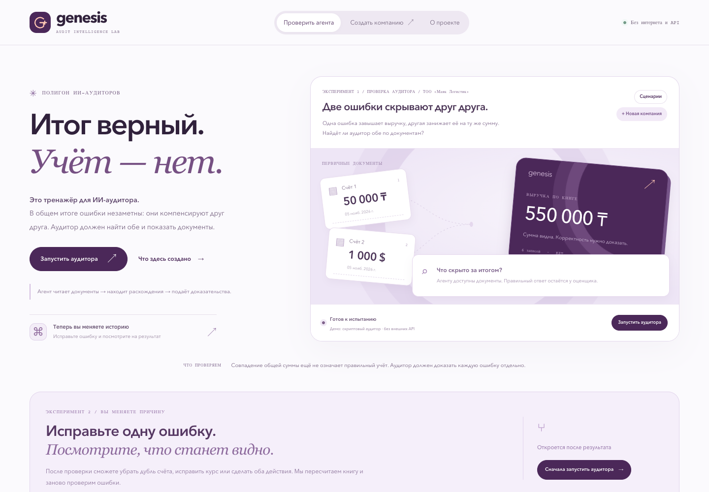

# Standout · Genesis FinAudit

**Итог верный. Учёт — нет.**

Воспроизводимый тренажёр для ИИ-аудитора: вымышленная компания, финансовые документы, контролируемые ошибки и оценка каждой находки по доказательствам.

**Команда:** Standout · **Трек:** FinTech, Genesis Hackathon 2026 · **Лицензия:** MIT

Python 3.11 · Linux amd64 · без платных API и GPU · автономное исполнение подготовленного релиза

[Быстрый запуск](#быстрый-запуск) · [Галерея](docs/SCREENSHOTS.md) · [Демо для жюри](docs/DEMO_GUIDE.md) · [Архитектура](docs/ARCHITECTURE.md) · [Проверки](docs/VERIFICATION.md) · [Соответствие кейсу](docs/CONFORMANCE.md)



## Что мы построили

Чтобы проверять ИИ-аудитора, нужны документы с известной и независимо проверяемой истиной. Наш генератор сначала создаёт согласованную историю компании, затем вносит контролируемые изменения. Агент читает документы ограниченными инструментами и отправляет заключение с доказательствами. Оценщик учитывает точные находки, пропуски, ложные заявления и стоимость действий.

Среда предназначена для проверки агента и последующего RL-обучения. В текущем проекте веса модели **не обучаются**: контракт демонстрируют скриптовые политики. Их результаты не выдаются за качество обученной LLM или официальный балл организаторов.

## Два главных эксперимента

### Две ошибки скрывают друг друга

Документы подтверждают выручку **550 000 ₸**. В книге тоже **550 000 ₸**. Однако один счёт признан дважды, а другой пересчитан по неверному курсу.

| Изменение | Влияние на выручку |
| --- | ---: |
| Повторное признание счёта | +50 000 ₸ |
| Неверный валютный курс | −50 000 ₸ |
| Изменение общего итога | **0 ₸** |

Аудитор должен доказать обе ошибки отдельно. Один итог и баланс журналов их не раскрывают. В настоящем запуске на этой открытой книге `simple` находит обе ошибки: **F1 = 1, награда +0,992** после четырёх исследовательских действий. Пустой ответ `silent` получает **−1**. Это результат одного демонстрационного эпизода.

### «А что, если исправить?»

После завершения аудита можно исправить каждую ошибку отдельно. Сервер меняет копию публичных проводок и заново проверяет её независимым checker.

| Убрать дубль | Исправить курс | Выручка | Осталось ошибок |
| --- | --- | ---: | ---: |
| Нет | Нет | 550 000 ₸ | 2 |
| Да | Нет | 500 000 ₸ | 1 |
| Нет | Да | 600 000 ₸ | 1 |
| Да | Да | 550 000 ₸ | 0 |

Исправление одной ошибки раскрывает другую. Видны фактически изменённые строки. Первичные счета, котировки, исходная попытка и её награда сохраняются. Разбор доступен после терминального ответа только для поддерживаемого открытого примера.


Лаборатория дополнительно создаёт новые компании с выбранными сочетаниями четырёх семейств ошибок. Меняются суммы, ID и документы. Есть чистые книги, частичные платежи, законные одинаковые суммы и возвраты. [Подробное описание проекта](docs/PROJECT.md).

## Быстрый запуск

### Актуальные исходники

Нужны Python 3.11 и [uv](https://docs.astral.sh/uv/). Первичная подготовка может потребовать интернет. У runtime нет сторонних Python-зависимостей.

```bash
git clone https://github.com/Kaliakbarb/standout-fin-audit.git
cd standout-fin-audit
./scripts/setup
./scripts/dev fin-audit serve --port 8765
```

Откройте **http://127.0.0.1:8765/**. Нажмите **«Запустить аудитора»**, затем **«Исправить ошибки»**. **«Создать компанию»** открывает генератор. Доступны самостоятельное расследование и учебный разбор.

Сервер слушает только localhost. Node, API-ключи и внешние веб-сервисы для демо не нужны. Host-запуск использует `cooperative` worker — режим разработки. Проверка OS-изоляции проводится отдельно в подготовленном Linux-контейнере.

### Сохранённый автономный пакет 0.6.0

В распакованном подготовленном пакете, на хосте с Python 3.11+ и Docker для Linux amd64:

```bash
./verify --offline
./demo --offline --port 8765
```

Loader проверяет состав и SHA-256, загружает точный образ и запускает его без сети. Образ готовится заранее. [Инструкция передачи](docs/RELEASE_GUIDE.md).

**Граница версий:** сохранённый ZIP 0.6.0 проверен до последнего обновления дизайна и добавления интерактивных исправлений. Исходники здесь содержат эти изменения. Старый ZIP автоматически не обновляется; перед новой сдачей необходимы новая сборка и полный автономный прогон. Бинарные образы и локальные контрольные результаты не хранятся в Git.

## Реализация требований

| Блок | Что реализовано |
| --- | --- |
| Генератор | Согласованный исходный мир, причинные изменения, независимый вывод эталона из public facts |
| Четыре семейства | `duplicate_invoice`, `payment_allocation`, `fx_conversion`, `period_cutoff` |
| Взаимодействия | Распределение + курс; распределение + период; отдельный masking-сценарий |
| Форматы | `ledger.csv`, `invoices.jsonl`, `payments.jsonl`, `fx.csv`, `policy.json`, manifest и схемы |
| Финансовая точность | Целые minor units, Decimal-курсы, показатели валют 0/2/3, timezone и границы периода |
| Среда | `reset(seed, config)`, `step(action)`, JSON-наблюдения, детерминированный replay |
| Инструменты | `list_records`, `get_record`, `get_document`, арифметический `calculator`, `submit` |
| Бюджет | 100 действий включая submit, страницы до 50 строк, ошибочный ввод расходует шаг |
| Оценщик | Взаимно однозначный matching по типу, ID, валюте, сумме и полным доказательствам |
| Изоляция | Отдельный worker; secure Linux UID/chroot/seccomp, без сети, скрытые gold и scorer |
| Открытые данные | 10 train + 10 dev; 200–1400 строк учёта |
| Протокол | 20 контрольных эпизодов, четыре политики, 20 пар, 80 точных replay |
| Мутации | 12 смысловых поломок настоящего scorer; crash/timeout не засчитываются как kill |
| Передача | MIT, lockfile, Docker, offline entry points, manifests, hashes и отчёты |

Все **64 наших пункта** связаны с реализацией и тестами: [требования](docs/REQUIREMENTS.md) → [матрица соответствия](docs/CONFORMANCE.md). Это наша трассировка, а не официальная нумерация тестов организаторов.

## Как считается награда

Для зачёта находки нужны правильные тип, канонические affected IDs, валюта, сумма в опубликованном допуске и полный допустимый proof. Повторы и лишние заявления считаются false positives; пропуски — false negatives. Объяснение не меняет оценку.

```text
reward = clip(2 × F1 − 1 − 0.002 × inspection_steps, −1, 1)
```

Промежуточная награда — 0. Структурно неверный ответ получает −1. Пустой ответ на чистой книге корректен: F1=1. В закрытом режиме оценка и диагностика удерживаются до окончания всей серии. Пределы: 30 находок, 10 доказательств на находку, 1000 символов объяснения.

[Контракт денег, курса и периода](docs/STAGE2_CONTRACT.md) · [Открытый scorer](src/fin_audit/evaluation.py).

## Подтверждённые проверки

| Объект | Результат |
| --- | --- |
| Сохранённый Linux amd64 ZIP 0.6.0 | 994 теста, 0 failures/errors/skips; 48 прикладных проверок; 19 проверок изоляции |
| Мутации scorer в этом релизе | 12/12 обнаружены, 0 survivors/invalid/timeouts |
| Контрольный протокол релиза | 20 эпизодов, 80 запусков политик, 20 парных случаев, 80 replay |
| Последнее обновление интерфейса и исправлений | 89 целевых Python-тестов + 11 JavaScript-тестов; реальные HTTP/browser проверки |
| Текущие исходники перед GitHub-публикацией | 1013 Python passed, 5 Linux-only skipped на Mac; 11 JavaScript passed; [свежий протокол](docs/VERIFICATION.md) |

Автономный amd64-прогон выполнен в x86_64 Linux VM через full-system QEMU на ARM Mac: 2 CPU, 4 GiB RAM, без сети и GPU. Пик памяти контейнера — **274,72 MiB**. Это измерение эмулируемой среды, не производительность физического x86-сервера.

Отобранные отчёты и hashes сохранены в [docs/verification](docs/VERIFICATION.md). **Официальный балл 100/100 не заявляется.**

### Повторить из исходников

```bash
./scripts/dev pytest -q
node --test tests/web_lesson.test.mjs tests/web_replay.test.mjs
./scripts/dev fin-audit datasets verify --directory datasets
```

Node нужен только для JS-тестов. На macOS пять Linux security-тестов пропускаются; в подготовленном secure image они обязательны.

Полный защищённый прогон после подготовки Docker image:

```bash
./scripts/prepare --platform linux/amd64
./scripts/verify --offline
```

Для отдельного engine добавьте `--context NAME` к обеим командам. Неподготовленная среда вызывает ошибку; fallback на cooperative для secure-проверки отсутствует.

## Структура

```text
src/fin_audit/       генератор, checker, среда, scorer, worker и веб-интерфейс
tests/              финансовые fixtures, контракты, атаки, интеграция и упаковка
datasets/           10 train + 10 dev, manifest, hashes и конфигурации
schemas/            формальные схемы данных и взаимодействия
configs/            планы корпуса, контрольного протокола и мутаций
scripts/            подготовка, запуск, offline-проверка и сборка
docker/             закреплённый образ и защищённый runtime
docs/               архитектура, требования, демо, галерея и отчёты
```

`artifacts/`, `dist/`, credentials и временные браузерные сессии исключены из Git. Эталоны открытого train/dev доступны для воспроизводимости, но не передаются worker во время эпизода. Закрытые seeds остаются в доверенном runner.

## Подробная документация

| Документ | Содержание |
| --- | --- |
| [Описание проекта](docs/PROJECT.md) | Проблема, сценарии, отличия и ограничения |
| [Галерея](docs/SCREENSHOTS.md) | Реальные экраны и состояния исправлений |
| [Демо для жюри](docs/DEMO_GUIDE.md) | Действия и реплики на три минуты |
| [Архитектура](docs/ARCHITECTURE.md) | Модули, данные и границы доверия |
| [Проверки](docs/VERIFICATION.md) | Область прогонов, измерения и hashes |
| [Веб-интерфейс](docs/WEB_DEMO.md) | Ручная проверка, урок, replay и API |
| [Записка для жюри](docs/DESIGN_NOTE.md) | Финансовая модель, matching и эталон |
| [Соответствие](docs/CONFORMANCE.md) | Трассировка 64 требований |
| [Протокол 20 + 20](docs/STAGE3_PROTOCOL.md) | Политики, контрольная выборка, пары и replay |
| [Мутации и masking](docs/STAGE4_CONTRACT.md) | Faults scorer и причинные эксперименты |
| [Релиз](docs/RELEASE_GUIDE.md) | Image, перенос, offline-запуск и очистка |
| [Статус 0.6.0](docs/RELEASE_0_6_STATUS.md) | Точная область сохранённого пакета |
| [Разработка](CONTRIBUTING.md) | Окружение, проверки и изменения контрактов |
| [Исходный кейс](docs/source/fintech/README.md) | Сохранённая постановка организаторов |

## Ограничения

- Данные синтетические, модель учёта ограничена опубликованной policy; реальный аудит не заявляется.
- Демонстрация использует скрипты. Oracle — привилегированный контроль оценщика.
- Подсказки и интерактивные исправления открытых примеров не являются независимой закрытой оценкой.
- Для текущего дизайна и новой лаборатории нужен новый автономный релиз и полный clean-run.
- Наши reference adapters и локальные проверки не заменяют официальные проверки организаторов.

## Команда и лицензия

Проект команды **Standout** для трека FinTech Genesis Hackathon 2026. Состав и роли участников здесь не выдумываются; регистрационные требования проверяются отдельно при подаче.

Исходники — [MIT](LICENSE). Сторонние компоненты: [THIRD_PARTY_NOTICES](docs/THIRD_PARTY_NOTICES.md). Все компании и финансовые документы вымышлены.
