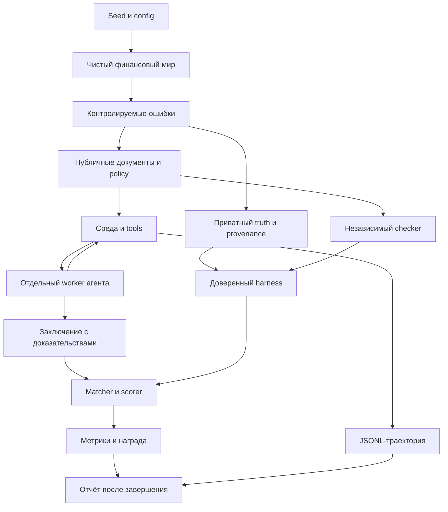

# Архитектура Genesis FinAudit

## Поток данных

Приватный эталон не является наблюдением агента. В закрытом режиме награда и диагностика удерживаются до завершения всей серии. Разбор открытых примеров расположен за пределами закрытого протокола.

## Модули

| Область | Файлы | Назначение |
| --- | --- | --- |
| Контракты | `contracts.py`, `money.py`, `schemas/` | Поля, деньги, время, сериализация |
| Генерация | `generator.py`, `native_generator.py`, `multi_generator.py` | Исходные миры и изменения учёта |
| Проверка | `checker.py`, `native_checker.py`, `multicurrency_checker.py` | Вывод ошибок из public facts |
| Хранение | `storage.py`, `corpus.py` | Эпизоды, manifest, hashes и открытый корпус |
| Представление | `presentation.py`, `transforms.py` | Имена, ID и порядок записей |
| Среда | `environment.py`, `calculator.py` | Tools, состояние, бюджет, завершение |
| Оценка | `evaluation.py` | Matching, TP/FP/FN, F1 и reward |
| Исполнение | `runner.py`, `agent_worker.py`, `sandbox_launcher.py` | Процесс агента, wire, timeout, secure |
| Протокол | `protocol.py`, `stage4.py`, `stage5.py` | Контрольные серии, пары, mutations, readiness |
| Отчёт | `reporting.py`, `showcase.py`, `showcase_report.py` | Траектории, manifests и HTML |
| Интерфейс | `web.py`, `web_assets/` | Локальный API, ручной аудит, replay и генератор |
| Исправления | `repair_lab.py` | Изменение копии открытой книги после ответа |
| Доставка | `scripts/prepare`, `verify`, `release.py`, `submission.py` | Image, проверка и автономный пакет |

## Финансовый контракт

Публичная часть: `manifest.json`, `policy.json`, `ledger.csv`, `invoices.jsonl`, `payments.jsonl`, `fx.csv`. Приватная: `truth.json`, `provenance.json`.

Деньги — целые minor units: 50 000 ₸ при exponent=2 представлены как `5000000`. Курсы — строки Decimal. ISO 8601 timestamps содержат offset. Период — `[start,end)` в timezone компании. Отсутствующие связи не угадываются.

Журналы остаются сбалансированными даже при предусмотренных ошибках. Проверяются основания признания, нормативная оценка и принадлежность периоду, а не только равенство дебета и кредита.

## Действия

| Tool | Результат |
| --- | --- |
| `list_records` | До 50 строк со стабильным cursor |
| `get_record` | Запись по ID |
| `get_document` | Первичный документ по ID |
| `calculator` | Ограниченная арифметика |
| `submit` | Терминальное заключение |

100 действий включают submit. Неверный ввод расходует шаг и возвращает ограниченную ошибку. Timeout или исчерпание бюджета дают truncated и пустой итоговый ответ. Терминальный результат неизменяем.

Calculator не предоставляет Python, SQL, shell, файлы или сеть. Ошибки tools не раскрывают пути trusted-процесса или эталон.

## Matching и награда

Максимальное взаимно однозначное сопоставление проверяет тип, канонические объекты, валюту, сумму в допуске и полный допустимый proof. Одна истина не засчитывает несколько одинаковых заявлений. Объяснение не влияет на matching.

Метрики — TP, FP, FN, precision, recall, F1 и reward. Оба пустых набора дают F1=1. Обычный reward: `clip(2*F1-1-0.002*inspection_steps,-1,1)`. Неверная структура ответа получает −1.

## Границы доверия

**Cooperative:** отдельный worker для разработки; обычный доступ к файловой системе хоста сохраняется. Этот профиль не доказывает OS-изоляцию.

**Secure:** Linux-контейнер без сети, readonly root, лимиты ресурсов. Worker имеет отдельный UID, chroot, seccomp и ограниченные file descriptors. Scorer и gold находятся вне worker. Проверка невозможностей профиля вызывает отказ, а не fallback.

**Веб:** сервер слушает loopback и предоставляет ограниченный API. Открытый repair endpoint доступен только после ответа, принимает ровно два boolean и не принимает произвольную клиентскую книгу. После изменения копии повторяется checker, проверяются баланс и неизменность исходных документов/попытки.

## Воспроизводимость и доставка

Случайность исходного мира, ошибок и представления разделена. Версии + seed + config определяют книгу. ID/order transforms сохраняют смысл. Replay сравнивает реальные наблюдения, завершение и награды; wall time измеряется отдельно.

Открытый корпус — 10 train + 10 dev. Контроль — 20 других миров, четыре политики на одном cohort, 20 пар, 80 replay. Oracle доступен только trusted evaluator.

Builder фиксирует source inventory, image, manifests и hashes. Loader проверяет переданный образ. Fresh clean-room перенос использует новый изолированный Docker store. Completed receipt относится к конкретному архиву; последующие исходники требуют новой сборки и проверки.

[Контракт данных](STAGE2_CONTRACT.md) · [Протокол](STAGE3_PROTOCOL.md) · [Мутации](STAGE4_CONTRACT.md) · [Релиз](RELEASE_GUIDE.md)
