# Галерея рабочего демо · Standout

Все изображения — настоящие браузерные снимки работающего интерфейса. Изображения не генерировались и не редактировались. Одни снимки показывают весь viewport, другие — отдельный блок страницы. Источники и SHA-256 перечислены в [manifest](images/manifest.json).

Галерея относится к последним исходникам с интерактивными исправлениями. Сохранённый автономный ZIP 0.6.0 содержит более ранний интерфейс; его Linux-проверки рассматриваются отдельно в [VERIFICATION](VERIFICATION.md).

## Главный экран

«Итог верный. Учёт — нет». На экране видны два исходных счёта и книга с выручкой 550 000 ₸. Правильность операций ещё предстоит доказать. Основное действие — «Запустить аудитора».

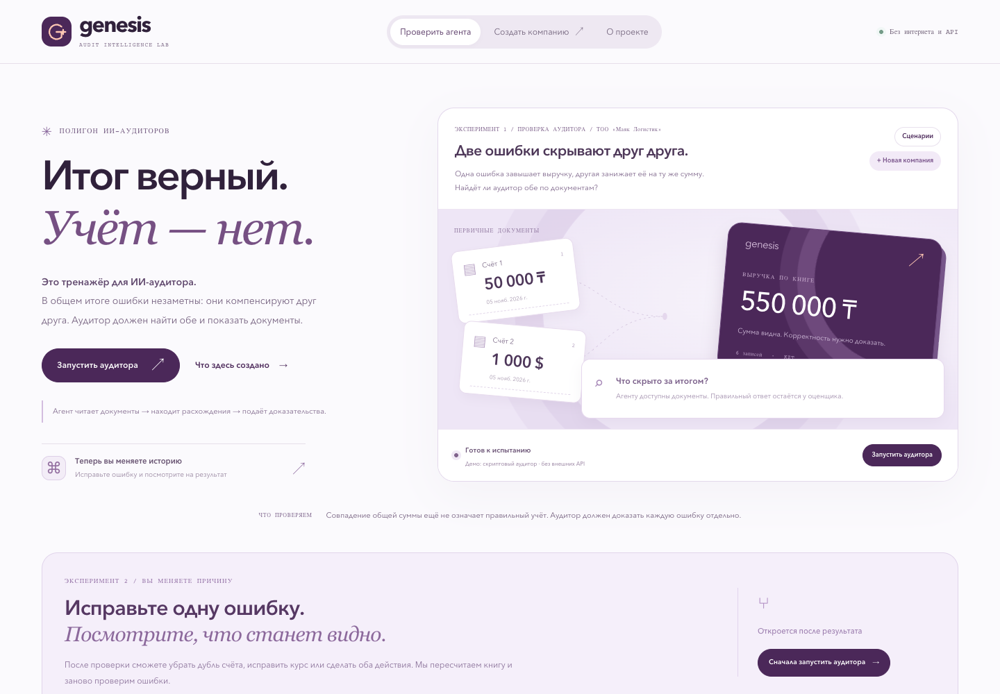

## Настоящее расследование

После запуска сервер завершает реальные процессы политик, затем интерфейс воспроизводит сохранённую траекторию. Агент обнаружил дубль и валютное занижение по 50 000 ₸. Общий итог сохранился.

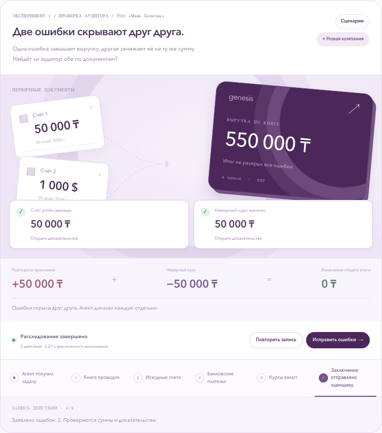

## Награда за доказательства

Сравниваются два ответа на одну книгу: пустое заключение и проверка документов. Указаны фактические находки, пропуски, ложные заявления и F1. Это результат одного открытого эпизода, не кривая обучения.

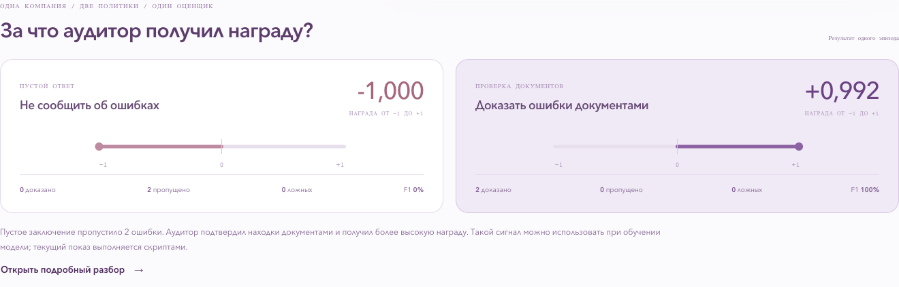

## Исправление как эксперимент

До исправлений — 550 000 ₸ и две ошибки:

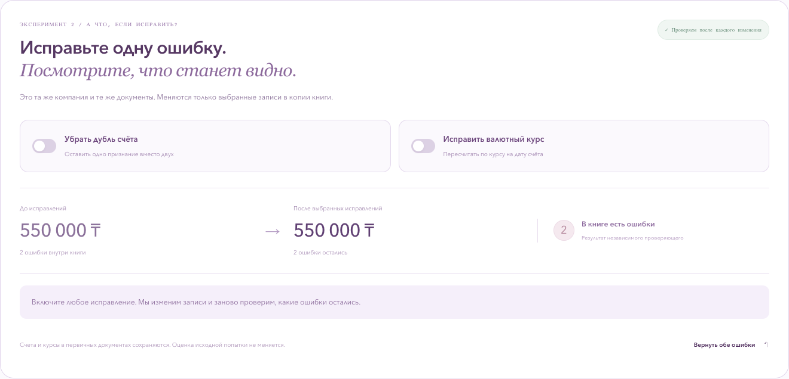

Убрали только дубль — стало 500 000 ₸, осталась валютная ошибка:

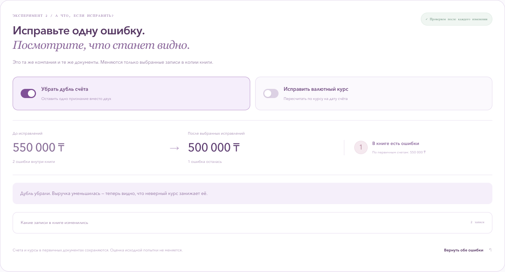

Исправили только курс — стало 600 000 ₸, остался дубль:

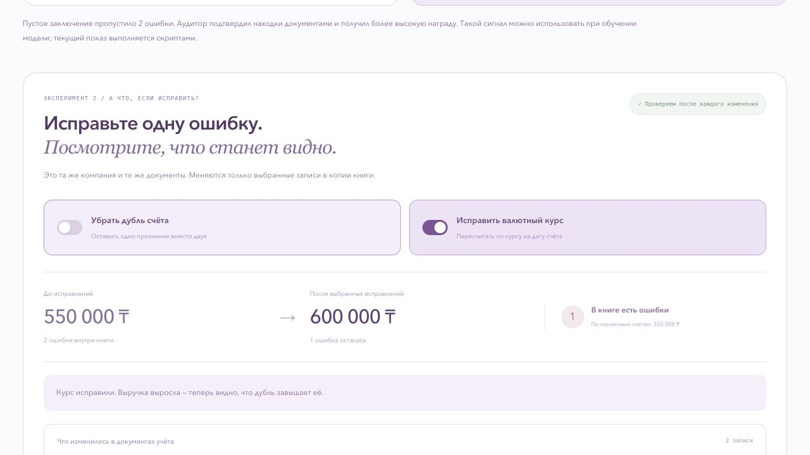

Исправили обе ошибки — снова 550 000 ₸, теперь ноль ошибок:

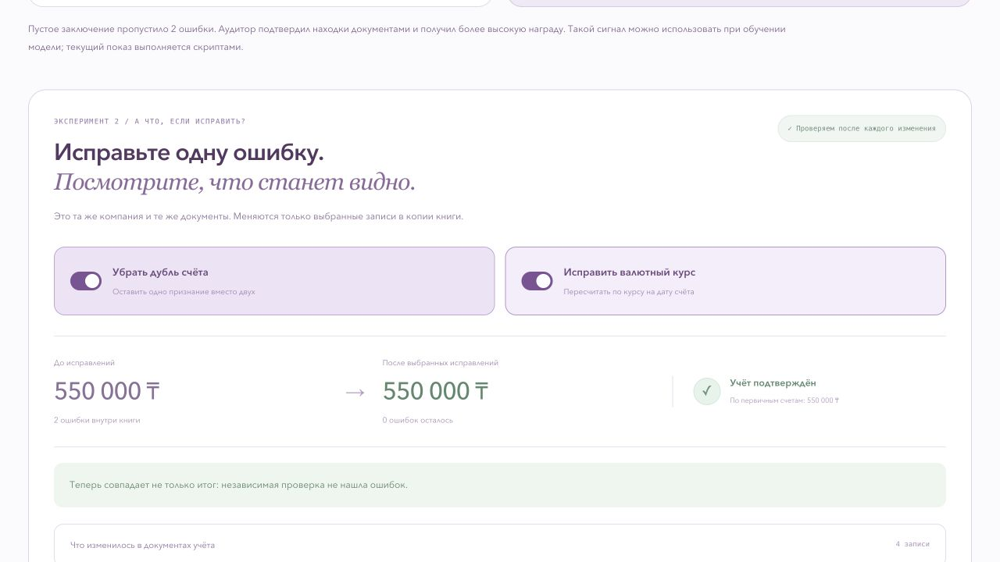

Так одинаковое итоговое число появляется и у корректной, и у ошибочной книги. Каждое состояние пересчитывается и проверяется сервером; исходная попытка сохраняется.

## Реальные строки до и после

Раскрывающийся блок показывает изменения конкретных проводок. В примере восстановления курса дебиторская задолженность и выручка изменились с 450 000 ₸ на 500 000 ₸. Первичные документы и котировки не изменились.

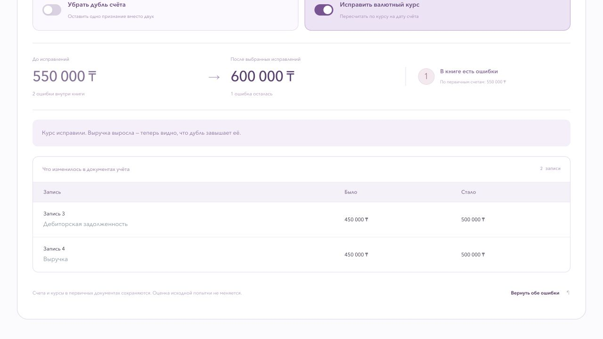

## Генератор новых компаний

Можно выбрать дубли, валюту, распределение и отчётный период. Пустой выбор создаёт чистую контрольную компанию. Параметры известны оператору лаборатории, но не выдаются агенту.

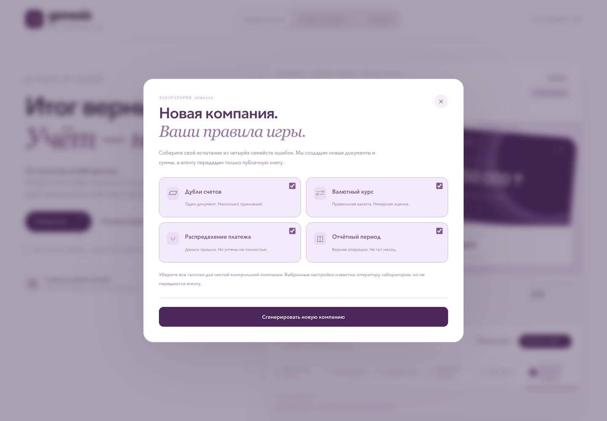

## Мобильный интерфейс

Снимки при ширине 390 px показывают одно исправление и оба исправления. Переключатели, итог и число ошибок помещаются по ширине.

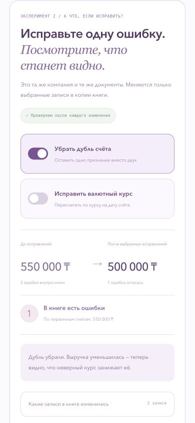

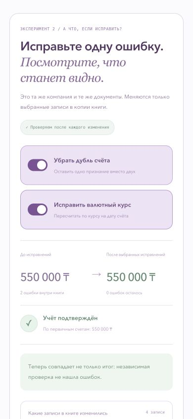

## Повторить

```bash
./scripts/setup
./scripts/dev fin-audit serve --port 8765
```

Откройте http://127.0.0.1:8765/, выполните [сценарий показа](DEMO_GUIDE.md). Локальное демо использует скриптовые политики. Все компании, суммы и документы синтетические.
